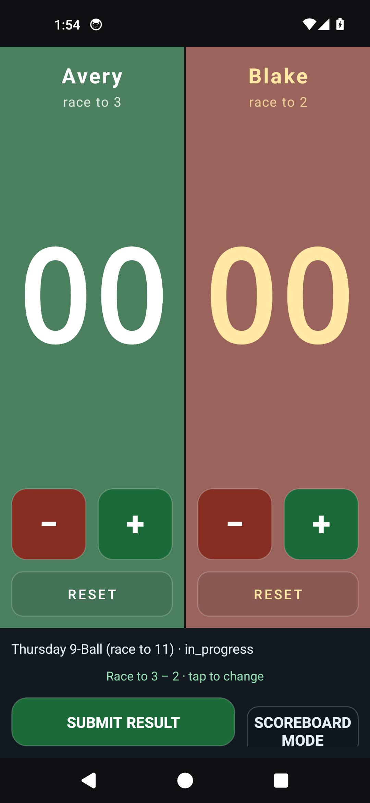
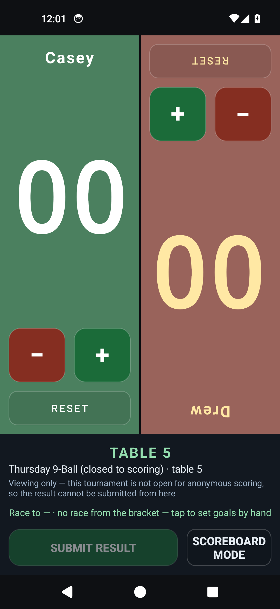

# Score — two-team scoreboard for Android

A single-screen score keeper for two teams. **HOME on the left, AWAY on the right** — tap the big
number to add a point, flick up or down to move the score, hold a team name to rename it.

## Download

**[⬇︎ Download `score-release.apk`](https://github.com/kevinelong/score-android/releases/latest)**

| | |
| --- | --- |
| Version | 1.5 (versionCode 6) |
| Size | 91,527 bytes |
| SHA-256 | `25d570c283a7349ca5b5c04216d19cafadd27fc8609f3572ec0f24895682f1e1` |
| Requires | Android 5.0 (API 21) or newer |
| Permissions | `INTERNET`, used only when you open a scoring link |
| Package | `com.kevin.score` |

Check the download before installing it — on Windows
`certutil -hashfile score-release.apk SHA256`, on macOS/Linux `shasum -a 256 score-release.apk`. The
build is reproducible, so that hash identifies the release exactly. The same file is committed to this
repository for a direct link:
[`score-release.apk`](https://github.com/kevinelong/score-android/raw/main/score-release.apk).

`sh verify-release.sh` does all of that in one go, against the live release: it downloads the published
asset and compares its size, SHA-256 and tag, the hash in the release notes, and the copy committed
here, and reads the APK's own versionName and versionCode — so a claim in this file that no longer
matches the bytes is caught rather than shipped.

## Install

Android only offers installs from the Play Store by default, so the first sideload needs one
permission and, on a Samsung, one security toggle:

1. Download the APK on the phone.
2. **Samsung: turn Auto Blocker off first.** Settings → **Security and privacy** → **Auto Blocker** →
   off. It is on by default on newer Galaxies and it refuses installs from outside the Play Store
   outright. Turn it back on afterwards; the installed app keeps working.
3. Open the file from **My Files** (or **Files**) → Downloads. The first attempt asks whether to allow
   installing from that app — tap **Settings** in the prompt and enable **Allow from this source**.
4. Google Play Protect warns that the app is not from the Play Store. That is expected for any
   sideloaded app — choose **Install anyway**.
5. Open **Score** from the app drawer.

With a computer and Android platform-tools instead:
`adb install -r score-release.apk` (needs USB debugging enabled and Auto Blocker off).

## How to use

- **Add a point:** tap the big number, or the green **+**.
- **Take a point off:** tap the red **−**.
- **Swipe up or down anywhere on either side** to move that side by one — up adds, down subtracts.
  The far side is drawn upside down, and its swipes are mirrored with it, so the player sitting
  opposite reads it upright and their "up" still adds. Hold the centre bar between the halves to flip
  it back if you are the only one scoring.
- **Reset a side:** the **Reset** button under its buttons. In a linked match it asks first, because
  there it clears a tally on its way to the server.
- **Rename a team:** press and hold the name for about a second. It dims while you hold, then the
  rename dialog opens; let go early and nothing happens. Names are limited to 16 characters, and
  clearing the name restores `HOME` / `AWAY`.
- Scores run `00`–`999` per side. A tournament race only needs two digits, but the point games it
  supports — 14.1 and 15-ball rotation — are played to 75, 100 or 150. Names and scores survive
  rotating the phone, and the screen is kept awake **and at full brightness** while the app is open:
  a pool room is dim, and a scoreboard that sleeps mid-match is useless.
- The first time you open it, a line at the bottom names the three gestures that are otherwise
  invisible. It goes away for good once you have scored something.

## Linked match mode

If a tournament director shares a **scoring link** with you, opening it on your phone loads that match
into the app: the two entrants appear as HOME and AWAY, you tally the points, and **Submit result**
records the winner on the tournament server (the tallies go with it). **Correct result** reopens a
match you already recorded, so a mistake can be fixed — the server keeps both versions.

Without the app installed, the same link opens the tournament's web console in a browser instead, so
the link always works. The app contacts only the host named in that link, and only to read the match
and send its result.

The board leads with the **table number** when the tournament has one, because that is what the
players are listening for. If the tournament is not open for outside scoring, the link still loads it
— entrants, table and match state, with the tallies working as a plain scoreboard — and says so, with
**Submit result** disabled, rather than showing an error over a blank screen. Coming back to the app
re-reads the match, so a correction made at the desk shows up without you doing anything.

**Races are supported too.** Tap the race line to give each side a target — different targets are a
handicap, like 11 against 9. The wording follows the discipline: a games race reads "Race to 7", while
14.1 and 15-ball rotation are scored in points and read "Points to 100". A side one point short of its
target says "match point". When either side reaches theirs the app tells you the match is over and
offers to submit the result, or to keep editing if that was a mistake.

## Privacy

Nothing leaves the phone unless you open a tournament scoring link. Opened normally from the home
screen, the app uses no network at all. The `INTERNET` permission exists for **linked match mode**,
where the app talks to the host of the link you opened — to read that one match and to submit its
result (the winner, the two team names and your tallies). No other host is contacted, there is no
account, no ads, no analytics, no third-party libraries, and nothing is collected, so there is nothing
to opt out of.

## Notes

- The app is signed with a 4096-bit RSA release key; signature schemes v1, v2 and v3 are all present,
  so it installs on every Android from 5.0 up.
- If you have an older copy installed, this release updates it in place — as long as it was signed
  with the same key, which it was.
- **Source:** the source lives in a separate, public repository —
  [kevinelong/score](https://github.com/kevinelong/score) — with the build scripts, the tools and the
  verification harness.
- **Licence:** **`FSL-1.1-MIT`** — the [Functional Source
  License](https://fsl.software/) ([full text](LICENSE)). In short: use, copy, modify and redistribute
  the app freely, **including commercially**, for anything except a competing product — you may not
  ship it as, or inside, a scoreboard that substitutes for this one. Two years after each release it
  becomes plain MIT. This makes it source-available rather than open source; if you need different
  terms, ask.
